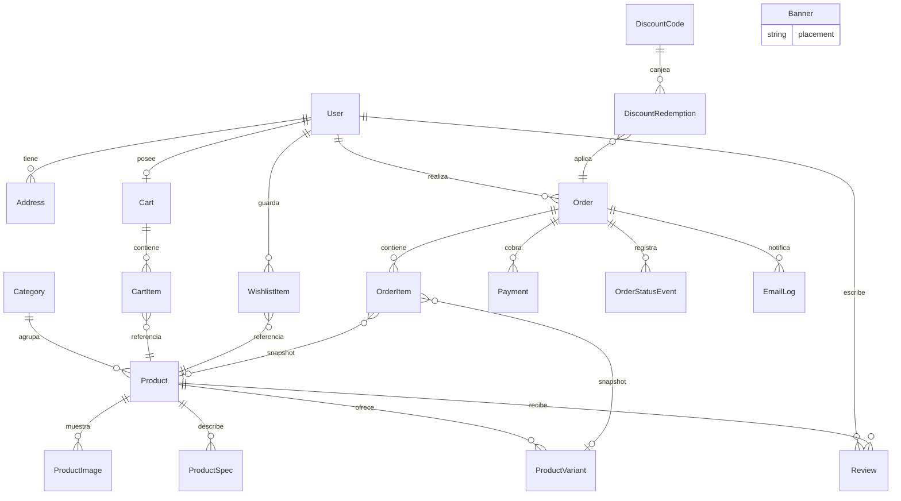

# Variedades Los Primos — Modelo de datos

Fuente de verdad: [`prisma/schema.prisma`](../prisma/schema.prisma). Este documento
explica las decisiones y cómo cada entidad respalda la UI ya construida.

**Decisiones acordadas (2026-07-12):**
- Productos con **variantes reales** (stock propio por variante).
- **Un solo modelo `User` con roles** (`ADMIN` / `CUSTOMER`).
- **Checkout de invitado permitido** (`Order.userId` opcional + snapshot).
- **Reseñas reales** (`Review` por usuario/producto; el rating se deriva).

Convenciones: enums en **inglés** (la UI los traduce), precios `Decimal(10,2)` en MXN,
ids `cuid()` salvo `Category.slug` (natural). Tablas en `snake_case` vía `@@map`.

## Diagrama



## Entidades y qué pantalla respaldan

| Entidad | Pantalla / funcionalidad |
|---|---|
| `User` (+ `Role`) | Login/registro, `/admin/users`, control de acceso al panel |
| `Address` | Varias direcciones por usuario; formulario de usuario del admin |
| `Category` | Barra de categorías, PLP, gestor de categorías |
| `Product` | Tarjetas, PDP, editor de producto (estado, destacado, badge, SKU) |
| `ProductImage` | Galería de la PDP y sección "Imágenes" del editor |
| `ProductSpec` | Filas clave/valor del editor y tab "Especificaciones" de la PDP |
| `ProductVariant` | Selector de color/talla de la PDP, con stock y SKU propios |
| `Review` | Tab "Reseñas"; `ratingAvg`/`reviewCount` en `Product` son cache derivada |
| `Cart` / `CartItem` | Carrito (usuario registrado por `userId`, invitado por `sessionId`) |
| `WishlistItem` | Página de favoritos |
| `Order` (+ snapshot) | Checkout y módulo `/admin/orders` |
| `OrderItem` | Artículos del pedido (snapshot de nombre/marca/precio) |
| `OrderStatusEvent` | Stepper Pagado→Empacando→Enviado→En camino→Entregado |
| `Payment` | `/admin/payments` y método elegido en checkout (1 orden : N intentos) |
| `DiscountCode` | `/admin/discounts` (código, tipo, vigencia, límite, saldo si es tarjeta) |
| `DiscountRedemption` | Qué orden usó qué código y cuánto descontó (`usedCount` se deriva) |
| `Banner` (+ `placement`) | `/admin/banners`: HERO, HERO_SIDE, PROMO, STRIP |
| `EmailLog` | Botón "Enviar correo al cliente" (historial + link de rastreo) |

## Decisiones de diseño

**Ofertas** — el precio base vive en `Product.price`; la oferta es `offerPrice` +
`offerActive` (el toggle de `/admin/offers`). La UI deriva: precio mostrado =
`offerPrice` si la oferta está activa, con `price` tachado. Apagar la oferta no
borra `offerPrice` (se conserva para reactivarla).

**Snapshots en órdenes** — `Order` copia contacto y dirección; `OrderItem` copia
nombre, marca, variante y precio unitario. Editar o borrar productos/perfiles
después no altera órdenes históricas (`onDelete: SetNull` en las referencias).

**Invitados** — `Order.userId` es nullable. El correo del snapshot (`Order.email`)
es el destino de las notificaciones aunque no exista cuenta.

**Rastreo** — `carrier`, `trackingNumber`, `trackingUrl` viven en `Order` y los
fija el admin; `EmailLog.includedTracking` registra si el correo llevó el enlace.

**Stock** — `Product.stock` aplica cuando no hay variantes; si las hay, el stock
real es la suma de `ProductVariant.stock` (la app lo resuelve, no la BD).

**Integridad** — `Category` usa `onDelete: Restrict` (no se puede borrar una
categoría con productos); carrito/reseñas/favoritos caen en cascada con su dueño.

## Mapeo de enums a la UI (español)

| Enum BD | Etiqueta UI |
|---|---|
| `PENDING / PAID / PACKING / SHIPPED / IN_TRANSIT / DELIVERED / CANCELLED` | pendiente / pagado / empacando / enviado / en camino / entregado / cancelado |
| `CARD / PAYPAL / EFECTY / TRANSFER / PSE` | Tarjeta / PayPal / Efecty / Transferencia / PSE |
| `COMPLETED / PENDING / REFUNDED / FAILED` | completado / pendiente / reembolsado / fallido |
| `PERCENT / FIXED / FREE_SHIPPING / GIFT_CARD` | porcentaje / monto fijo / envío gratis / tarjeta de regalo |
| `PUBLISHED / DRAFT / ARCHIVED` | publicado / borrador / archivado |

## Cómo usarlo

```bash
npm run db:migrate   # crea las tablas (requiere DATABASE_URL válida)
npm run db:seed      # siembra catálogo, banners, descuentos y usuarios demo
```

El seed es idempotente (upserts). La app sigue en mock (`USE_DATABASE="false"`)
hasta que actives el flag.

## Fuera de alcance (siguientes fases)

- Multi-vendedor ("Vende en Variedades Los Primos"), inventario multi-almacén.
- Direcciones de facturación separadas de envío.

> **Actualización (2026-07-13):** la autenticación quedó implementada **sin tablas
> extra**: sesión JWT firmada en cookie httpOnly (`vlp_session`) + `passwordHash`
> en `User`. El modelo completo está en producción local: la API (`src/app/api/**`)
> y los servicios (`src/lib/server/**`) leen y escriben todas estas tablas.
